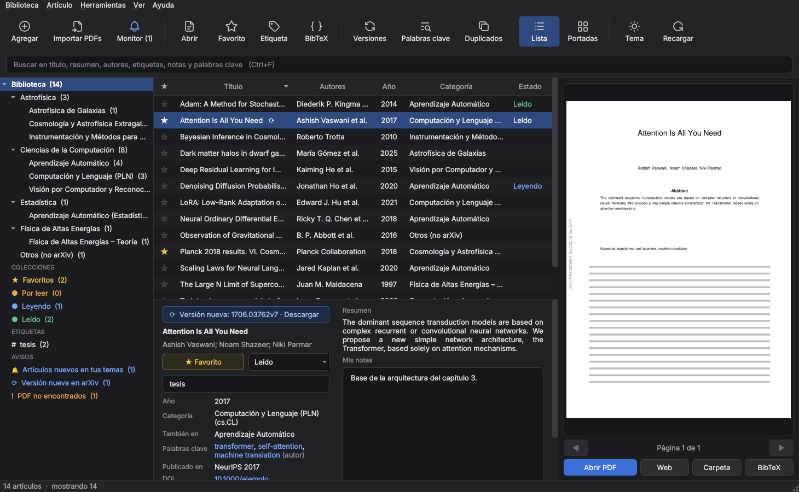
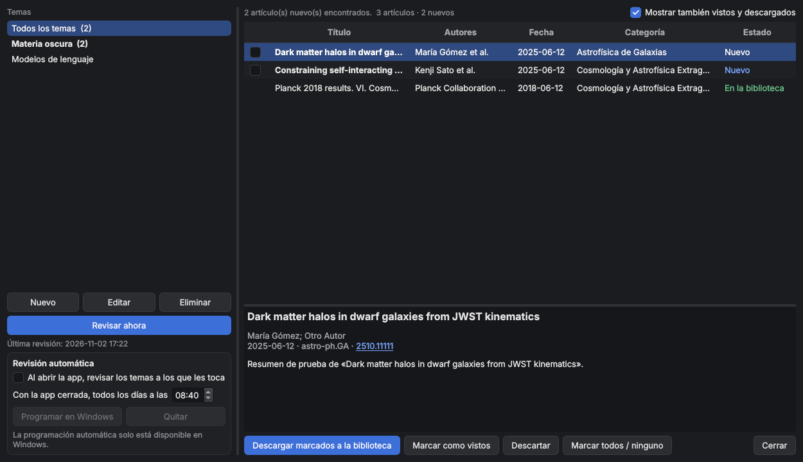
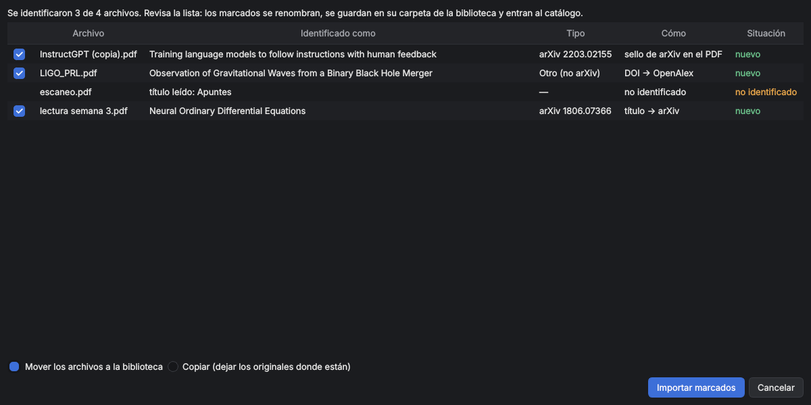
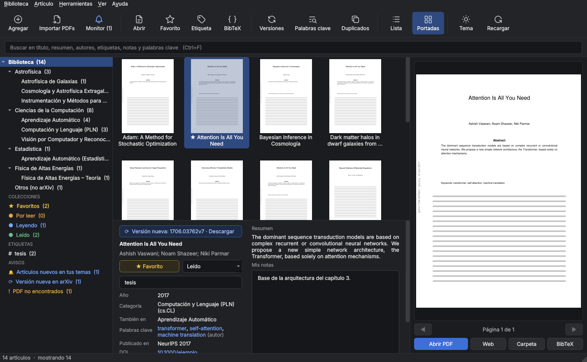
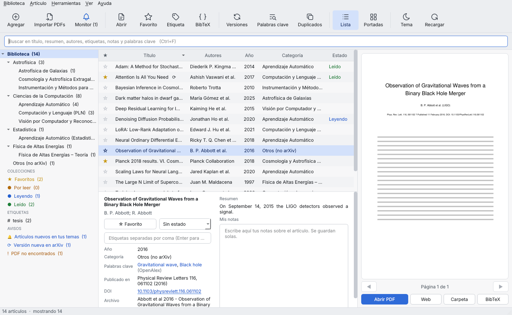

# Biblioteca arXiv

Aplicación de escritorio para organizar una biblioteca personal de artículos científicos, al estilo de [calibre](https://calibre-ebook.com/) pero pensada para papers: renombra los PDF con su título, los clasifica por la categoría de arXiv, guarda la metadata en un catálogo consultable con SQL y vigila arXiv para avisarte de artículos nuevos en los temas que te interesan.

*Desktop app to organize a personal library of scientific papers (calibre-like). Interface available in Spanish and English.*



## Funciones

**Biblioteca**
- Renombra los PDF descargados de arXiv (`2410.05229v1.pdf` → `Autor et al 2024 - Título.pdf`) y los ordena en carpetas por área y subcategoría (`Computer Science (cs)/cs.LG - Machine Learning/`).
- Catálogo SQLite con toda la metadata de la API de arXiv: título, autores y afiliaciones, resumen, categorías, fechas, DOI, revista y comentarios. También genera un CSV para Excel.
- Navegación por área y subcategoría (nombres en español o inglés), búsqueda de texto completo sin importar tildes, vista de lista o de portadas.
- Vista previa grande del PDF con paso de páginas.

**Incorporar artículos**
- **Agregar por código:** pega códigos o enlaces de arXiv en cualquier formato.
- **Importar PDFs:** identifica archivos aunque tengan otro nombre. Lee las dos primeras páginas y busca el sello de arXiv, el DOI de arXiv, el DOI de revista o el título; consulta arXiv u OpenAlex. Los artículos que no son de arXiv van a *Otros (no arXiv)* con su metadata de revista.

**Organización personal**
- Favoritos, estado de lectura (Por leer / Leyendo / Leído), etiquetas y notas.
- Se guardan en tablas aparte del mismo catálogo, así que el script de descargas nunca los borra.

**Herramientas**
- **BibTeX:** copia o exporta referencias (`@misc` con `eprint` para arXiv, `@article` para revistas).
- **Versiones nuevas:** detecta artículos con una versión más reciente en arXiv y la descarga conservando notas y etiquetas.
- **Palabras clave:** las del autor (línea *Keywords* del PDF) y las de [OpenAlex](https://openalex.org/).
- **Duplicados:** encuentra copias sobrantes y PDF que el catálogo no usa. Nunca borra: mueve a `_duplicados`.

**Monitoreo de temas**
- Registra temas con palabras o frases, categorías y autores opcionales, y frecuencia diaria o semanal.
- La app los revisa al abrirse. Opcionalmente se programa en el Programador de tareas de Windows para revisar aunque la app esté cerrada y avisar con una notificación.
- Desde la ventana del monitor se descargan los artículos elegidos directo a la biblioteca.

**Interfaz**
- Tema claro y oscuro, español e inglés, barra de iconos.

| Monitor de temas | Importar PDFs |
|---|---|
|  |  |

| Portadas | Tema claro |
|---|---|
|  |  |

## Instalación

Requiere **Python 3.10 o superior**.

**Windows (lo más simple):** doble clic en `Iniciar.bat`. La primera vez instala las dependencias y luego abre la app sin consola.

**Manual (cualquier sistema):**
```bash
pip install -r requirements.txt
python app.py
```

La primera vez la app busca el catálogo en `D:\Biblioteca_arXiv`; si no lo encuentra, pide elegir la carpeta y la recuerda en `config.json`.

## Script de línea de comandos

`renombrar_arxiv.py` hace lo mismo sin interfaz y es útil para procesar discos completos. Sin `--aplicar` solo simula.

```bash
# Renombrar y clasificar descargas
python renombrar_arxiv.py D:\Biblioteca_arXiv --biblioteca D:\Biblioteca_arXiv --aplicar

# Descargar desde una lista de códigos (txt o csv, cualquier formato)
python renombrar_arxiv.py --biblioteca D:\Biblioteca_arXiv --descargar Pendientes.txt --aplicar

# Buscar artículos de arXiv en discos completos y llevarlos a la biblioteca
python renombrar_arxiv.py C:\Users\usuario D:\ --recursivo --biblioteca D:\Biblioteca_arXiv --aplicar

# Catalogar lo que ya está en la biblioteca / regenerar el CSV
python renombrar_arxiv.py --reconstruir-catalogo --biblioteca D:\Biblioteca_arXiv
python renombrar_arxiv.py --exportar-csv --biblioteca D:\Biblioteca_arXiv
```

Todas las opciones: `python renombrar_arxiv.py --help`.

## Estructura de la biblioteca

```
D:\Biblioteca_arXiv\
├── Computer Science (cs)\
│   └── cs.LG - Machine Learning\
│       └── Kingma et al 2014 - Adam A Method for Stochastic Optimization.pdf
├── Astrophysics (astro-ph)\ …
├── Otros (no arXiv)\ …
├── catalogo_arxiv.sqlite     ← catálogo (SQL)
├── catalogo_arxiv.csv        ← tabla de artículos para Excel (separador ;)
├── renombrados_arxiv.csv     ← registro de movimientos (para deshacer)
└── .miniaturas\              ← vistas previas en caché (se regeneran solas)
```

### Tablas del catálogo

| Tabla | Contenido |
|---|---|
| `articulos` | Metadata de arXiv u OpenAlex y ruta del PDF; incluye nombres de categoría en español (`area_es`, `categoria_es`) |
| `autores` | Un registro por autor, con orden y afiliación |
| `categorias` | Categorías principal y secundarias de cada artículo |
| `busqueda` | Índice de texto completo (FTS5) sobre título, resumen y autores |
| `personal` | Favorito, estado de lectura y notas |
| `etiquetas` | Etiquetas propias |
| `palabras_clave` | Palabras clave con su fuente (autor, OpenAlex, tema) |
| `versiones_nuevas` | Avisos de versiones más recientes en arXiv |
| `monitores`, `novedades` | Temas monitoreados y artículos encontrados |

Ejemplo, artículos por categoría:

```sql
SELECT area_es, categoria_es, COUNT(*) AS n_articulos
FROM articulos
GROUP BY area_es, categoria_es
ORDER BY n_articulos DESC;
```

## Código

| Archivo | Rol |
|---|---|
| `app.py` | Ventana principal, modelos de lista y portadas, ficha y vista previa |
| `dialogos.py` | Ventanas de agregar, importar, monitor, versiones y duplicados |
| `datos.py` | Acceso al catálogo (lectura y datos personales) |
| `tareas.py` | Trabajos en segundo plano: arXiv, OpenAlex, identificación de PDF, monitor |
| `renombrar_arxiv.py` | Núcleo compartido con el script de línea de comandos |
| `monitor.py` | Revisión de temas sin abrir la app (la usa el Programador de tareas) |
| `bibtex.py` | Generación de referencias BibTeX |
| `temas.py` | Temas claro y oscuro, iconos SVG |
| `i18n.py`, `i18n_en.py` | Idioma de la interfaz y traducciones al inglés |

Los textos se escriben en español en el código con `tr("…")`. Para traducir uno nuevo, agrégalo a `i18n_en.py`.

## Servicios externos

- [API de arXiv](https://info.arxiv.org/help/api/index.html): metadata, búsquedas y PDF. La app respeta la pausa de 3 segundos entre consultas que pide arXiv y reintenta ante errores 429/503.
- [OpenAlex](https://docs.openalex.org/): palabras clave e identificación de artículos de revista.

No requiere cuentas ni claves.

## Pendiente

- Perfiles de revista (por ejemplo JAAVSO) reconocidos por el encabezado del PDF, con identificador de NASA ADS.
- Ejecutable `.exe` (PyInstaller).
